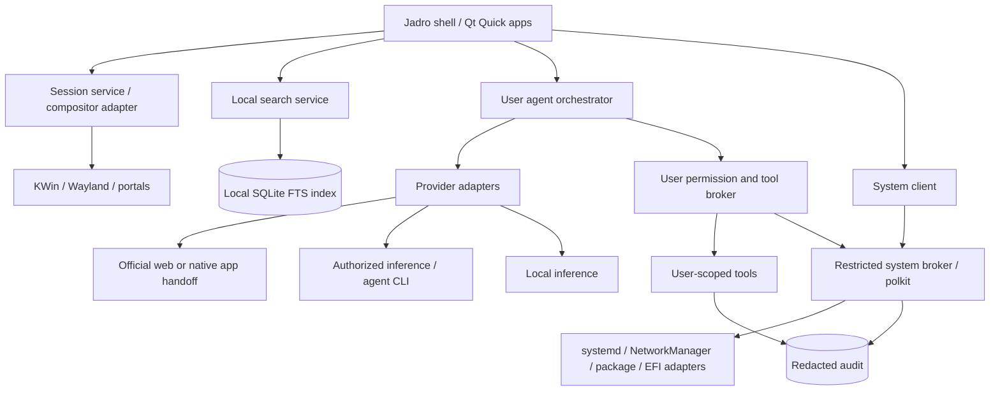
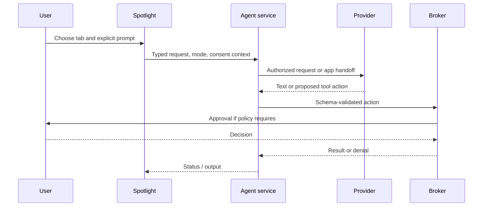

# System architecture
Status: proposed; no services below are installed by the scaffold.

## Boundaries and ownership
| Component | Responsibility | Execution context |
|---|---|---|
| shell | Dock, menu, switcher, notifications, dialogs | logged-in user |
| compositor adapter | windows, focus, workspaces, effect hooks | session/compositor, no remote access |
| Spotlight/search | local ranking, provider selection, action discovery | user service |
| agent orchestrator | plan state, cancellation, budgets, tool proposals | isolated user process |
| provider adapters | official handoff/auth, normalize events | user process, credentials scoped |
| tool broker | validate schema, classify risk, enforce approval and grants | user service |
| system broker | typed operations only, validate caller and target | root system service via polkit |
| index/state | SQLite FTS, settings and job history | user-owned directories |
| update/recovery | signed packages, snapshot coordination | privileged, interactive |
| boot helper | enumerate/validate EFI entry and one-time switch | privileged, interactive |
| app/game managers | launch and compatibility metadata | user; system installs brokered |

Use session D-Bus for desktop APIs and system D-Bus for narrowly typed admin APIs; use private Unix sockets for sandboxed child streams only when required. Names proposed: org.jadroos.Search1, Agent1, Session1, System1. Derive callers from bus credentials; never trust client-supplied uid. Avoid a localhost HTTP server for local IPC.

## Request sequence

Official website handoff is not an agent loop and does not grant tool access. Provider text, webpages and files are untrusted data. The provider may propose, never authorize, local execution.

## Data layout
XDG_CONFIG_HOME/jadroos: preferences; XDG_DATA_HOME/jadroos: conversation/task metadata; XDG_STATE_HOME/jadroos: bounded redacted logs; XDG_CACHE_HOME/jadroos: thumbnails and regenerable indexes; XDG_RUNTIME_DIR: private sockets. Secrets only via Secret Service/KWallet, no tokens in SQLite or config. /etc/jadroos: administrator policy; /var/lib/jadroos: root-owned state. Backward-compatible migrations, rollback and explicit export/delete controls. No cloud sync by default.

## Reliability
Process isolation, systemd user services with restart/backoff and bounded resources, request IDs and deadlines, cancel propagation, typed errors, idempotency keys for changes, schema version negotiation. On compositor/plugin failure offer upstream Plasma fallback. On provider failure preserve unsent prompt and do not change billing mode automatically. On authorization failure deny; never fall back to a shell with broader rights.

## Extension strategy
Use upstream KDE/Wayland protocols where available. Prototype KWin scripts and effects on a pinned tested release; prefer upstream changes over private ABI hooks. Do not build a new compositor unless documented gaps cannot be solved. Native Qt Quick applications use a shared component library; GTK/browser/Electron apps are not guaranteed to match native surfaces.
