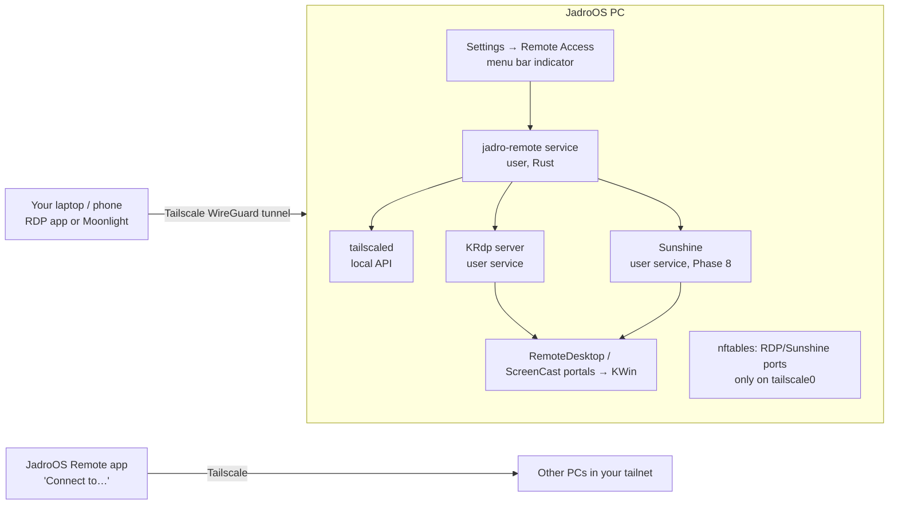

# Remote access over Tailscale

**What:** a built-in AnyDesk/Parsec-style remote desktop. You can control this PC from your other devices, and control your other PCs from JadroOS. All traffic goes through your own **Tailscale** network (tailnet), never the open internet.

**When:** Phase 6 for everyday remote desktop and the "Connect to…" app; Phase 8 for low-latency game streaming. See the [roadmap](../planning/roadmap.md). Requirements REM-01 to REM-03 in [requirements.md](../product/requirements.md).

## Two modes

| Mode | Feels like | Built on | Good for | Phase |
|---|---|---|---|---|
| **Remote Desktop** | AnyDesk / TeamViewer | **KRdp** (KDE's RDP server for KWin Wayland, via the RemoteDesktop/ScreenCast portals and PipeWire) | Everyday control from any device: Windows' built-in Remote Desktop, Microsoft's RDP apps on Mac/iPhone/Android, Remmina/KRDC on Linux | 6 |
| **Game Streaming** | Parsec / Steam Link | **Sunshine** (host) + **Moonlight** (clients), hardware encoding (NVENC on the RTX 3070) | Low-latency, high-FPS streaming, games, controller input | 8 |

Both use the same Tailscale setup, on/off switches, indicator and security rules.

## How it fits together

| Part | What it does | Owner |
|---|---|---|
| `tailscaled` (upstream package) | Joins the tailnet; sign-in through Tailscale's official browser flow | Codex (packaging, setup) |
| `jadro-remote` user service (Rust, `services/remote/`) | Reads Tailscale status from its local API, starts/stops KRdp and Sunshine, tracks active sessions, writes the connection log, exposes `org.jadroos.Remote1` on D-Bus to the UI | Codex |
| Firewall rules (static nftables file shipped in the package) | Remote ports reachable **only** on the `tailscale0` interface; blocked on every other interface | Codex |
| Settings → **Remote Access** pane | Tailscale sign-in state, this PC's tailnet name, on/off per mode, unattended access option, allowed users, connection history | Claude |
| Menu bar **remote session indicator** | Visible whenever someone is connected: who, from which device, one-click **Disconnect** | Claude |
| **Remote** app ("Connect to…") | Lists devices in your tailnet, connects with the built-in RDP client (or Moonlight for streaming), remembers favorites | Claude (UI), Codex (client backends) |

The Remote app wraps existing clients instead of writing a new one: an RDP client library or Remmina/KRDC for Remote Desktop, Moonlight for Game Streaming. T6.8 picks the client and records the choice.

## Setup flow (what the user sees)

1. Settings → Remote Access → **Sign in to Tailscale**: opens Tailscale's official login in the browser. JadroOS never sees the Tailscale password.
2. Turn on **Allow remote control of this PC**. JadroOS sets a separate remote password for RDP (stored in the keyring, never in config files).
3. Optional: **Allow unattended access** (connect without someone at the PC clicking Accept). Off by default, with a clear warning.
4. On another device: install Tailscale and an RDP app (or Moonlight), sign into the same tailnet, connect to `<pc-name>` (the tailnet name).

Connecting *from* JadroOS: open the Remote app, pick a device, connect.

## Security rules

Remote control means full control of the PC, so these rules are hard requirements:

- **Off by default.** Nothing listens until the user turns a mode on.
- **Tailnet only.** Remote ports are bound or firewalled to `tailscale0`. No port forwarding, no Tailscale Funnel, no public exposure. A test checks the ports are closed on every other interface.
- **Two locks.** A connection needs both tailnet membership (ideally restricted further with Tailscale ACLs to the user's own devices) **and** the remote password (RDP) or a paired client (Sunshine PIN pairing).
- **Consent through the portal.** Screen capture and input always go through KWin's RemoteDesktop/ScreenCast portals. Attended mode asks the person at the PC every time. Unattended mode only uses a supported, revocable way of remembering that permission. If the pinned KRdp/KWin version has none, unattended access waits until one exists; never bypass the portal.
- **Always visible.** The menu bar indicator shows any active session, and Disconnect works from it. A notification appears when a session starts and ends.
- **Lock screen stays secure.** A remote user who reaches the lock screen must type the password like anyone else; remote access never unlocks or skips it.
- **Logged.** Connection log with time, device, user and duration in the user's state directory; no screen content recorded.
- **No new root code.** Phase 6 uses only upstream mechanisms: `tailscaled`'s own service, systemd/polkit actions for starting it, a static firewall file from the package, and a one-time `tailscale set --operator=<user>` done by the installer or the owner. Custom privileged code stays in Phase 7.
- **AI agents can't use it.** Remote access is for people. AI desktop control is a separate feature (T7.5) with its own consent; the agent service cannot turn remote access on.

## Open questions (answered by the tickets)

| Question | Answered in |
|---|---|
| How KRdp handles consent for unattended sessions on the pinned KWin version | T6.7 |
| How to reach the PC after a reboot before anyone has logged in (auto-login + lock screen, or wait for a supported headless-session login) | T6.7 |
| Which RDP client to embed in the Remote app | T6.8 |
| Sunshine capture method under KWin (portal vs. KMS capture and its required permissions) | T8.7 |
| Wake-on-LAN through another always-on tailnet device | T8.7 (optional) |

## For development right now

You don't have to wait for Phase 6 to use remote access yourself. You can already install `tailscale` and KDE's RDP server (or Sunshine) on the dev machine by hand and connect through your tailnet. That is a manual owner setup, not part of the JadroOS code.
