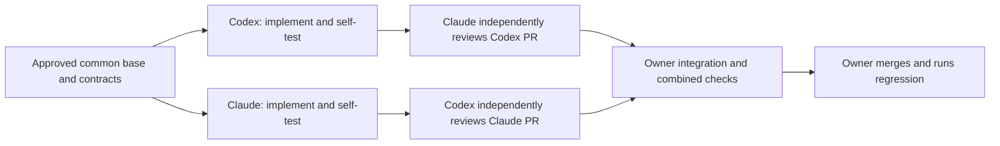

# Dual-agent engineering workflow
Both Codex and Claude Code are full-cycle implementers. Each writes production code, tests, runs checks, investigates failures and fixes defects in their own area. Neither is merely a reviewer or designer. Cross-review is a second independent gate, not a substitute for author validation. See [ownership](code-ownership.md), [quality gates](quality-gates.md) and [startup guide](vm-setup.md).

## Operating model
- Owner/integrator assigns tickets, resolves architectural disagreements, approves shared contracts, sensitive operations and merges.
- Codex leads platform/backend/session/services; Claude leads shell/design/system-app UI. Both may implement integration code after explicit ownership agreement.
- Use separate branches and worktrees, independent build directories, no shared uncommitted edits. Worktrees prevent ordinary edit collisions, not malicious access. Agents use workspace-scoped permissions; for stronger isolation use separate VMs or separate Unix accounts and independent clones.
- Shared contract changes require a small owner-approved contract PR before either dependent implementation starts.
- Each agent reads the latest merged documentation, checks ticket dependencies, and records base SHA, files owned and test plan before edits.
- The owner relays tasks/review requests through GitHub issues/PRs or terminal prompts; no automatic inter-agent communication is assumed.
- Never grant unattended root, host filesystem access, provider tokens belonging to the other agent, or unrestricted approval bypass.

## Per-ticket sequence
1. Claim one ticket; confirm expected output, acceptance criteria, ownership and base commit.
2. Create named branch from current main. Write or update regression tests, implement the smallest complete change.
3. Compile, run scoped and affected regression tests, lint, check negative/error cases, fix failures and rerun. Capture exact commands, versions, exit codes and limitations.
4. Push branch and open PR using template. Do not merge or change another agent's branch.
5. Owner asks other agent to review specific PR SHA in separate worktree. Reviewer independently reproduces relevant checks, seeks defects and adds findings with severity, file/line and reproduction.
6. Author fixes findings on own branch, reruns checks. Reviewer rechecks changed SHA; stale approval does not apply.
7. Owner integrates against latest main, runs combined tests, resolves interface changes in a separate integration branch, and merges only after gates pass.
8. Post-merge run main smoke/regression; if failure, owner reverts or creates fix ticket; never conceal failures by disabling tests.

## Parallel work

Do not let cross-review become an infinite loop: freeze author SHA, review it, then return to assigned implementation. Both PRs can remain open; resolve contract PRs first. Integration tests use isolated DBus services or mocks until real broker is approved.

## Evidence and stop conditions
Record work in PR, not a shared editable status file. Test output must be actual, not inferred. A skipped or unavailable check is NOT a pass. Stop if a required environment, contract, license or privilege is unavailable. A successful mock test does not prove hardware, firmware, authentication or real compositor behavior. No methodology guarantees zero bugs.
